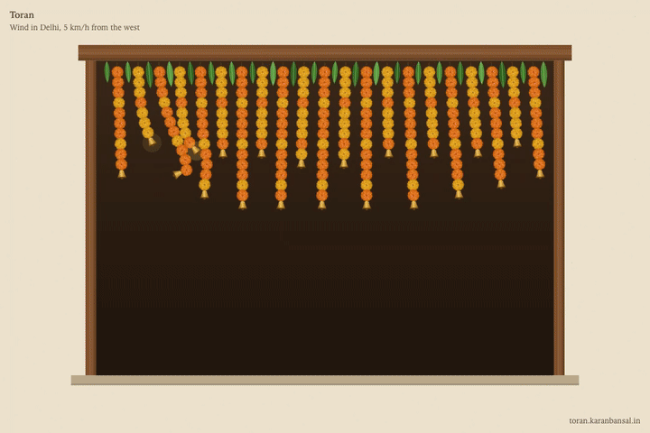

# Toran

A toran is a garland hung over an Indian doorway on festival days. This one hangs in your browser. Brush the marigolds with a finger or mouse to ring the brass bells. The wind in your city sets the strings swaying.

**[Play Toran](https://toran.karanbansal.in/)** and tap the speaker to hear the bells.

[](https://toran.karanbansal.in/)

## What it does

- Grab a string and let it swing. Each bell plays a note from Raag Bhupali.
- Try the [marigolds](https://toran.karanbansal.in/#genda), [mango-leaf thoranam](https://toran.karanbansal.in/#aam) or [beaded moti toran](https://toran.karanbansal.in/#moti).
- Pick a city or share your location. When the wind rises above 12 km/h, it rings the bells on its own.
- Tap a leaf with a yellow knot to read someone's memory of a door. You can [hang a memory of your own](https://github.com/karanb192/toran/issues/new?template=door.yml).

There is one secret.

## How it works

JavaScript draws the garland on an HTML canvas. Verlet physics lets each string sag and swing. The Web Audio API synthesizes the bell notes. The page has no build step or runtime dependencies.

<details>
<summary>Wind, sound and recording</summary>

The first city comes from your time zone. Toran caches [Open-Meteo](https://open-meteo.com/) wind readings for 30 minutes. If a request fails, it keeps the last reading for that place or uses a gentle breeze.

The **Clip** button records five seconds on supported browsers. Turn on the speaker before recording to include the bells. Toran also follows your system's reduced-motion setting.

The sound choice stays in local browser storage. If storage is blocked or cleared, the next visit starts muted. Restoring sound waits for an interaction to respect [browser audio policies](https://developer.chrome.com/blog/autoplay/#web-audio).

On a first visit, the speaker pulses gently twice over three seconds to point out the bells. A page opened in a background tab waits until it becomes visible before starting or marking the hint as seen. The hint stops when you tap the speaker and does not repeat after a reload or a saved sound choice. Reduced motion and blocked storage skip the hint.

</details>

## Run it

```sh
python3 -m http.server 8391
```

Then open http://127.0.0.1:8391. Tests run with `npm test` (Node 20 or newer).

Browser regressions use [Playwright](https://playwright.dev/) as a development dependency. They start a separate local server on port 8392 and mock weather responses.

```sh
npm ci
npx playwright install chromium
npm run test:browser
```

To use an existing Chrome installation, run `PLAYWRIGHT_CHANNEL=chrome npm run test:browser` instead of installing Chromium.

## Add a door

Anyone can add one line about a door they remember through the [Add a door](https://github.com/karanb192/toran/issues/new?template=door.yml) form. When the maintainer labels the issue `approved`, a workflow opens a pull request that adds the line to `doors.json`. Merged lines hang on leaves with a yellow knot. Tap one to read it.

The workflow needs "Allow GitHub Actions to create and approve pull requests" turned on under Settings, Actions, General.

Door pull requests created with `GITHUB_TOKEN` need a maintainer to select **Approve workflows to run** before their CI checks start. See [GitHub's workflow trigger rules](https://docs.github.com/en/actions/how-tos/write-workflows/choose-when-workflows-run/trigger-a-workflow#triggering-a-workflow-from-a-workflow).

Something wrong about a region's toran? [Suggest a fix](https://github.com/karanb192/toran/issues/new?template=fix.yml).

## Contributing

See [CONTRIBUTING.md](CONTRIBUTING.md). Security reports go to the address in [SECURITY.md](SECURITY.md).

## Credits

Inspired by [Chimes](https://marinabudarina.github.io/chimes/) by [Marina Budarina](https://budarina.design), a beaded doorway curtain for every country. The strings use Verlet physics, the approach in [Liam Egan's CodePen](https://codepen.io/shubniggurath/pen/ZYpjorm) that Chimes builds on. No code, art or sound from either is used here. Wind data by [Open-Meteo](https://open-meteo.com/), CC BY 4.0.

## License

MIT, see [LICENSE](LICENSE).
